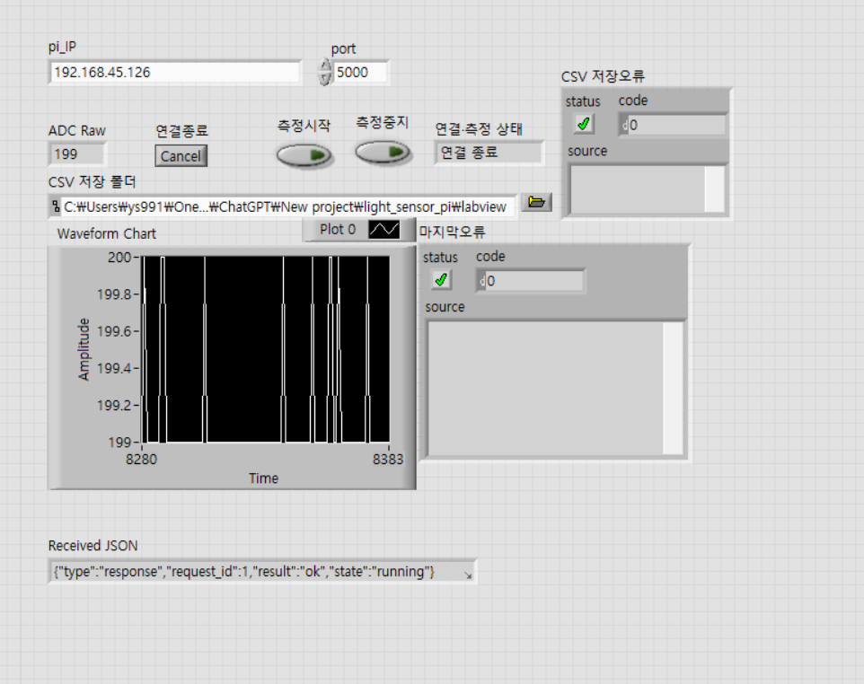
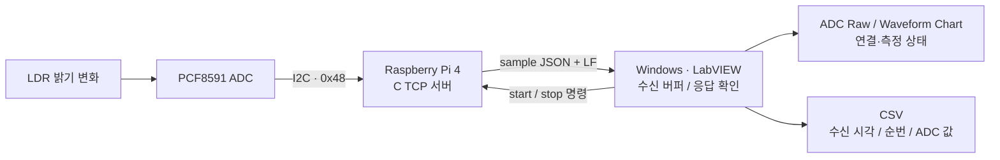
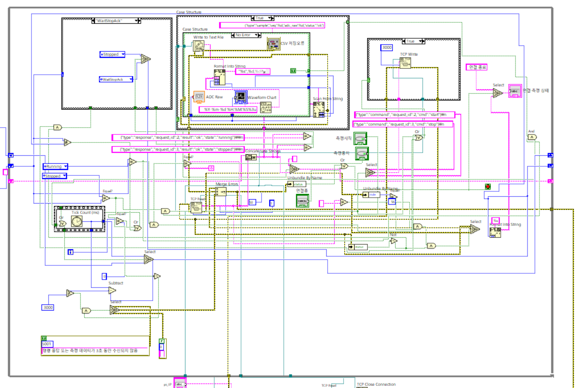
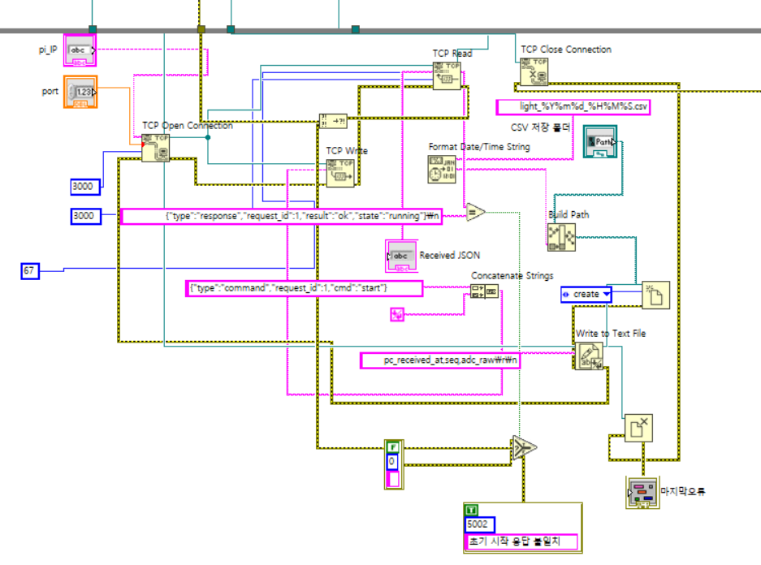
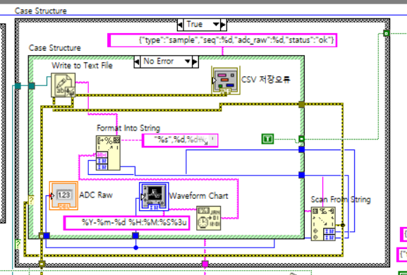
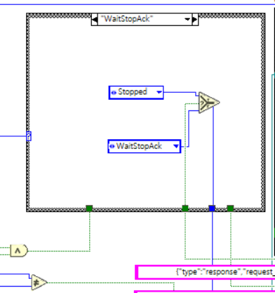
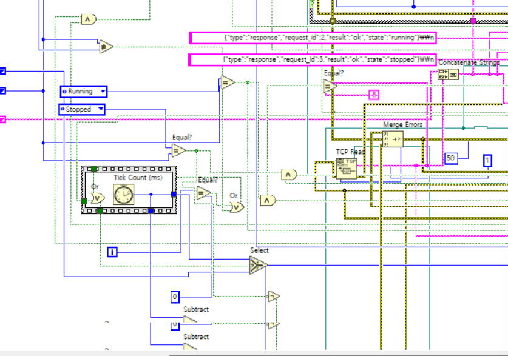
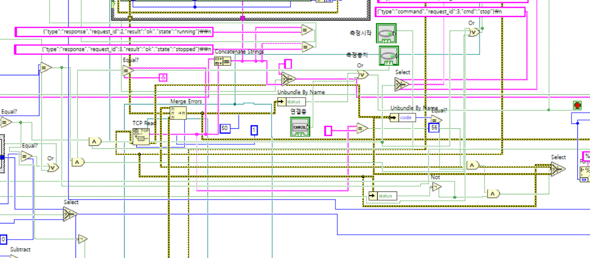
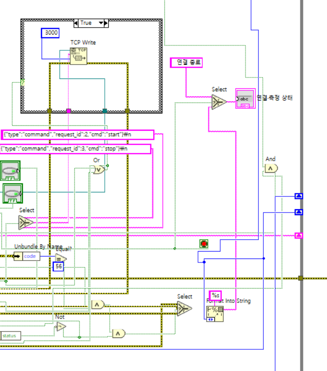
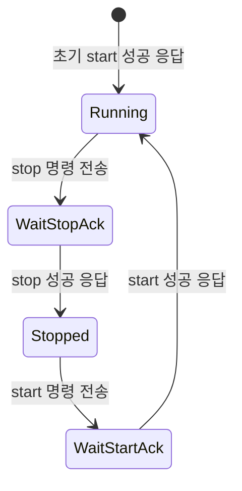

# 💡 Light Sensor Monitor — Raspberry Pi × LabVIEW

Raspberry Pi 4와 PCF8591 조도 센서 모듈에서 읽은 **ADC 값을 TCP로 전송하고, Windows의 LabVIEW에서 실시간 그래프와 CSV로 기록하는 개인 프로젝트**입니다.

센서의 I2C 수집부터 C 소켓 서버, JSON 명령·응답, LabVIEW 화면과 상태 전이, 파일 저장 및 통신 오류 처리까지 하나의 측정 흐름으로 구성했습니다.


---

## 📌 프로젝트 개요

| 항목 | 내용 |
|---|---|
| 작업 형태 | 개인 프로젝트 |
| 개발자 | [이윤상](https://github.com/ys991113-debug) |
| 구현 범위 | 센서 수집, TCP 서버, LabVIEW 측정 화면, CSV 기록, 오류 처리 |
| 측정 장치 | Raspberry Pi 4, LDR을 포함한 PCF8591 ADC 모듈 |
| 장치 인터페이스 | I2C `/dev/i2c-1`, 주소 `0x48`, 사용 채널 AIN0 |
| 통신 방식 | TCP Socket, 줄바꿈으로 구분한 JSON 메시지 |
| 서버 설정 | 기본 포트 `5000`, 수집 주기 설정 `100 ms` |
| 클라이언트 환경 | Windows, LabVIEW 2026 Q3 64-bit |
| 저장 데이터 | PC 수신 시각, 샘플 순번, ADC 원시값 |

**표시하는 값은 0~255 범위의 8-bit ADC 원시값입니다.** LDR의 밝기 변화에 따른 상대적인 변화를 관찰하며, 보정된 조도 단위인 lux로 환산하지 않았습니다.

### 주요 기능

- PCF8591의 AIN0~AIN3을 비교해 센서가 연결된 채널 확인
- C 서버에서 선택한 ADC 채널을 읽어 TCP 클라이언트로 전송
- LabVIEW의 숫자 표시기와 Waveform Chart로 수신값 표시
- 측정 시작·중지 명령 전송과 성공 응답(ACK)에 따른 상태 전환
- 실행별 CSV 파일 생성 및 샘플별 수신 시각·순번·센서값 기록
- 짧은 수신 대기와 통신 오류를 구분하고, 3초 무응답 시 자동 종료
- TCP 연결 종료와 파일 닫기를 포함한 종료 처리

---

## 🖥️ 실행 화면



사진은 측정을 마친 뒤 `연결 종료` 상태에서 남아 있는 ADC 값과 그래프 이력입니다. `CSV 저장오류`와 `마지막 오류`의 code가 모두 `0`인 종료 화면을 담았습니다. 화면 속 IP와 저장 폴더는 개발 환경의 예시입니다.

| 화면 요소 | 역할 |
|---|---|
| `pi_IP` / `port` | Raspberry Pi 서버의 현재 주소와 TCP 포트 입력 |
| `ADC Raw` | 마지막으로 수신한 ADC 원시값 표시 |
| `Waveform Chart` | 수신한 ADC 값의 변화 이력 표시 |
| `측정시작` / `측정중지` | TCP 연결을 유지하면서 수집 시작·중지 명령 전송 |
| `연결종료` | 측정 루프를 끝내고 소켓과 파일 자원 정리 |
| `연결·측정 상태` | `Running`, `Stopped`, ACK 대기 및 연결 종료 상태 표시 |
| `CSV 저장 폴더` | 실행할 때 새 CSV 파일을 생성할 기존 폴더 선택 |
| `CSV 저장오류` | 반복문 안에서 샘플을 기록하는 파일 쓰기 블록의 오류 표시 |
| `마지막 오류` | VI 종료 시점의 최종 오류 표시 |
| `Received JSON` | 연결 직후 받은 초기 시작 응답 확인 |

`마지막 오류`는 종료 경로에서 갱신됩니다. 실행 중에는 이전 실행의 표시가 남아 있을 수 있으므로, 현재 실행의 최종 결과는 `연결종료` 후 확인합니다. 그래프의 X축은 차트의 샘플 이력이며, 샘플별 실제 PC 시각은 CSV에 별도로 기록합니다.

---

## 🏗️ 시스템 구조



| 구성 요소 | 맡은 역할 |
|---|---|
| LDR·PCF8591 모듈 | 빛에 따른 아날로그 신호를 8-bit 디지털 값으로 변환 |
| Raspberry Pi | Linux I2C 장치 파일을 통해 센서에 접근하고 네트워크 서버 실행 |
| C TCP 서버 | 수집 스케줄 관리, JSON 명령 해석, 응답 및 샘플 전송 |
| LabVIEW 클라이언트 | TCP 수신·명령 전송, 상태 관리, 값 표시 및 파일 기록 |
| Python 시험 클라이언트 | LabVIEW와 별도로 서버의 명령·데이터 송수신을 확인하는 도구 |

서버는 한 번에 클라이언트 한 대를 처리합니다. 연결이 끝나면 수집을 중지하고 다음 연결을 기다립니다. LabVIEW에서 재접속할 때는 VI를 다시 실행합니다.

---

## 🧩 LabVIEW 블록 다이어그램과 역할

### 전체 측정 루프



While Loop 안에서 명령 전송, 한 줄 수신, 샘플 처리, 상태 전이와 오류 판단을 반복합니다. 시프트 레지스터는 **누적 수신 문자열, 측정 상태, 타이머 기준값**을 다음 반복으로 전달합니다. 연결 및 CSV 초기화는 루프 진입 전에 수행하고, TCP·파일 닫기는 루프 종료 후 수행합니다.

아래 상세 사진은 전체 다이어그램의 각 영역을 확대한 것입니다. 항목을 펼치면 사용한 블록과 데이터 흐름을 볼 수 있습니다.

<details>
<summary><strong>① 연결 초기화·CSV 생성·종료 처리</strong></summary>



| 블록·영역 | 역할 |
|---|---|
| `TCP Open Connection` | 입력한 주소와 포트로 Raspberry Pi에 접속 |
| 초기 `TCP Write` | `request_id:1`의 `start` 명령과 LF 전송 |
| 초기 `TCP Read`·문자열 비교 | 시작 성공 응답을 읽고 예상 응답과 일치하는지 확인 |
| 오류 `5002` | 초기 시작 응답이 예상 문자열과 다를 때 사용할 오류 구성 |
| `Format Date/Time String` | 실행 시각을 파일명 문자열로 변환 |
| `Build Path` | 선택한 저장 폴더와 `light_YYYYMMDD_HHMMSS.csv` 파일명 결합 |
| `Open/Create/Replace File` | 새 CSV 파일을 만들고 파일 참조 전달 |
| 초기 `Write to Text File` | `pc_received_at,seq,adc_raw` 헤더 기록 |
| `TCP Close Connection`·`Close File` | 측정 루프가 끝난 뒤 연결과 파일 자원 반환 |
| `마지막 오류` | 종료 경로를 거친 오류 클러스터 표시 |

초기 성공 응답은 현재 서버 형식을 기준으로 LF를 포함한 67바이트를 읽습니다. 파일 생성이나 통신 초기화에서 발생한 오류도 이후 오류선으로 전달합니다.

</details>

<details>
<summary><strong>② 샘플 해석·차트 표시·CSV 한 행 기록</strong></summary>



| 블록·영역 | 역할 |
|---|---|
| 샘플 처리 `Case Structure` | 완성된 수신 줄에 대한 샘플 처리 영역 |
| `Scan From String` | 정해진 sample JSON 형식에서 `seq`와 `adc_raw` 추출 |
| 안쪽 `No Error` Case | 해석 오류가 없는 경로에서 값 표시와 행 기록 수행 |
| `ADC Raw`·`Waveform Chart` | 센서값을 숫자와 그래프 이력으로 표시 |
| `Format Date/Time String` | 샘플을 처리하는 PC의 시각 생성 |
| `Format Into String` | PC 시각·순번·ADC 값을 CSV 한 행으로 구성 |
| 반복문 안 `Write to Text File` | 열어 둔 CSV 파일에 샘플 행 기록 |
| `CSV 저장오류` | 샘플 쓰기 블록의 오류 클러스터 표시 및 오류선 전달 |
| True 상수·출력 터널 | 유효 샘플 처리 신호를 타이머 갱신 로직에 전달 |

파일 참조를 루프 밖에서 생성해 전달하므로 샘플마다 파일을 새로 만들지 않습니다.

</details>

<details>
<summary><strong>③ 시작·중지 ACK를 기다리는 상태 전이</strong></summary>



사진은 `WaitStopAck` Case입니다. `stop` 성공 응답을 확인하면 `Stopped`를 선택하고, 응답을 기다리는 동안에는 `WaitStopAck`를 유지합니다. 시작 경로도 `WaitStartAck`에서 성공 응답을 확인한 뒤 `Running`으로 전환합니다.

버튼을 누른 순간과 장치가 명령을 처리한 순간을 구분하기 위해 **명령 전송 후 ACK를 기다리는 상태**를 두었습니다. 상태 출력은 시프트 레지스터를 통해 다음 반복에서 사용합니다.

</details>

<details>
<summary><strong>④ 3초 무응답을 판단하는 타이머</strong></summary>



| 블록·영역 | 역할 |
|---|---|
| `Tick Count (ms)` | 경과 시간 계산에 사용할 밀리초 기준값 획득 |
| 상태·샘플 처리 조건 | 상태 전환이나 유효 데이터 수신에 맞춰 기준 시각 갱신 |
| 시프트 레지스터·`Select` | 새 기준 시각을 선택하거나 이전 기준값 유지 |
| `Subtract`·임계값 비교 | 현재 시각과 기준 시각의 차이를 3,000ms와 비교 |
| 오류 `5001` | 명령 응답 또는 측정 데이터가 3초 동안 없을 때 종료 경로로 전달 |

측정 중과 ACK 대기 상태에서 무응답을 감시합니다. 정상적인 `Stopped` 상태는 데이터가 오지 않아도 유지하도록 구분했습니다.

</details>

<details>
<summary><strong>⑤ 한 줄 수신 버퍼와 TCP·파일 오류 통합</strong></summary>



| 블록·영역 | 역할 |
|---|---|
| 반복문 안 `TCP Read` | 1바이트 단위로 읽고 50ms 시간 초과 설정 사용 |
| `Concatenate Strings` | 이전 반복의 문자열과 새 수신 바이트 결합 |
| LF 비교·`Select` | 줄바꿈 도착을 판단하고 다음 반복의 누적 버퍼 결정 |
| ACK 문자열 비교 | 완성된 응답이 시작·중지 성공 응답과 일치하는지 확인 |
| `Unbundle By Name: code` | TCP Read 오류 번호 추출 |
| `Equal? 56`·빈 문자열·이전 오류 조건 | 데이터가 없는 짧은 수신 대기를 실제 오류와 구분 |
| `Merge Errors` | 통신, CSV 쓰기 및 무응답 감시 오류를 종료 판단에 반영 |
| `Unbundle By Name: status`·OR | 오류 발생 또는 사용자 종료 요청으로 루프 종료 |

TCP는 메시지 경계를 보장하지 않으므로 한 번 읽은 결과를 바로 JSON 한 건으로 취급하지 않습니다. 바이트를 모아 LF가 도착한 한 줄을 처리합니다. 오류 `56`도 모든 상황에서 지우지 않고, 수신 대기로 판단되는 조건에서만 처리합니다.

</details>

<details>
<summary><strong>⑥ 측정 명령 전송과 연결·측정 상태 표시</strong></summary>



| 블록·영역 | 역할 |
|---|---|
| `측정시작`·`측정중지` 조건 | 현재 상태와 버튼 입력을 바탕으로 전송 여부 판단 |
| 명령 문자열용 `Select` | `request_id:2`의 start 또는 `request_id:3`의 stop 선택 |
| `TCP Write`를 포함한 Case | 명령 전송 조건이 참인 반복에서 JSON 명령 전송 |
| 상태 시프트 레지스터 | 현재 상태를 유지하고 계산한 다음 상태 저장 |
| `Format Into String`·표시용 `Select` | 상태 이름 또는 `연결 종료` 문구를 화면에 전달 |
| 루프 종료 조건 | 사용자 종료와 오류 조건을 모아 실행 종료 |

`측정중지`는 서버에 stop 명령을 보내며 TCP 연결을 유지합니다. `연결종료`는 측정 루프를 끝내고 종료 처리로 이동합니다.

</details>

### 측정 상태 흐름



각 ACK 대기 상태는 성공 응답을 받기 전까지 유지됩니다. 사용자 연결 종료, 통신 오류 또는 감시 시간 초과는 루프 종료 경로에서 처리합니다.

---

## 🔁 TCP JSON 프로토콜

모든 메시지는 **JSON 한 줄 + LF(`\n`)** 형식입니다. 서버는 `start`, `stop`, `status`를 지원하며, `request_id`는 명령과 응답을 대응시키는 값입니다.

### LabVIEW에서 사용하는 요청

| 상황 | request_id | cmd |
|---|---:|---|
| 연결 직후 초기 측정 시작 | 1 | `start` |
| 화면에서 측정 재시작 | 2 | `start` |
| 화면에서 측정 중지 | 3 | `stop` |

```json
{"type":"command","request_id":1,"cmd":"start"}
```

```json
{"type":"response","request_id":1,"result":"ok","state":"running"}
```

```json
{"type":"sample","seq":0,"adc_raw":199,"status":"ok"}
```

```json
{"type":"command","request_id":3,"cmd":"stop"}
```

```json
{"type":"response","request_id":3,"result":"ok","state":"stopped"}
```

`request_id`별 명령은 클라이언트가 선택합니다. Python 시험 클라이언트는 1번을 `status`, 2번을 `start`, 3번을 `stop`으로 사용합니다. 서버가 `stopped`에서 새 수집을 시작하면 `seq`는 0부터 다시 증가합니다.

---

## 💾 CSV 저장 형식

선택한 기존 폴더 아래에 실행 시각으로 파일을 생성합니다.

```text
light_YYYYMMDD_HHMMSS.csv
```

```csv
pc_received_at,seq,adc_raw
"2026-10-29 18:23:17.563",0,202
"2026-10-29 18:23:17.617",1,202
```

| 열 | 의미 |
|---|---|
| `pc_received_at` | LabVIEW가 샘플을 처리한 PC의 시각. 센서에서 측정한 시각과는 차이가 있을 수 있음 |
| `seq` | Raspberry Pi 서버가 부여한 수집 순번. 측정을 다시 시작하면 0으로 초기화 |
| `adc_raw` | PCF8591에서 읽은 ADC 원시값, 0~255 |

개발 중 생성한 `labview/light_*.csv` 실측 파일은 `.gitignore`로 제외합니다. 저장 폴더는 직접 선택하며, 파일 생성 블록이 누락된 상위 폴더까지 자동으로 만들지는 않습니다.

---

## 🧰 기술 스택과 소스 구성

| 영역 | 기술 |
|---|---|
| 센서 수집 | Linux `i2c-dev`, `open` / `ioctl` / `read` / `write` |
| 서버 | C11, POSIX TCP Socket, `poll`, `CLOCK_MONOTONIC`, 시그널 처리 |
| 메시지 | LF로 구분한 JSON 명령·응답·샘플 |
| PC 화면·제어 | LabVIEW TCP 함수, While Loop, Case Structure, 시프트 레지스터 |
| 데이터 표시·저장 | Waveform Chart, 문자열 포맷, File I/O, CSV |
| 보조 도구 | Python 3, GCC, GNU Make, Git |

```text
light_sensor_pi/
├── light_sensor_server.c       # ADC 수집 + 단일 클라이언트 TCP 서버
├── pcf8591_reader.c            # AIN0~AIN3 센서 채널 확인 도구
├── tcp_test_client.py          # 명령·샘플 송수신 시험 클라이언트
├── Makefile                   # C 프로그램 두 개 빌드
├── labview/
│   ├── Light_Monitor.vi       # 최종 측정·표시·CSV·오류 처리 VI
│   └── Status_Test.vi         # 통신 확인 과정에서 사용한 보조 VI
├── docs/images/                # 프런트 패널 및 블록 다이어그램 사진
└── README.md
```

서버의 ADC 읽기는 PCF8591이 먼저 반환하는 이전 변환값을 버리고 두 번째 바이트를 사용합니다. `poll`로 명령 수신과 주기 수집을 처리하며, 별도 장치 제어 라이브러리 없이 Linux I2C 장치 파일에 접근합니다.

---

## 🚀 빌드와 실행

### 1. Raspberry Pi 준비·빌드

Raspberry Pi에서 I2C 인터페이스를 활성화하고, PC와 Raspberry Pi를 서로 통신 가능한 같은 네트워크에 연결합니다.

```bash
git clone https://github.com/ys991113-debug/light-sensor-labview.git
cd light-sensor-labview
sudo apt update
sudo apt install -y build-essential i2c-tools
sudo i2cdetect -y 1
make
```

`i2cdetect` 결과에서 PCF8591의 `48` 주소를 확인합니다. `make`는 `pcf8591_reader`와 `light_sensor_server`를 생성합니다. I2C 장치 권한이 없는 경우에만 실행 계정의 권한을 확인하거나 `sudo`로 시험합니다.

### 2. 센서 채널 확인

```bash
./pcf8591_reader
```

`time_s,AIN0,AIN1,AIN2,AIN3`가 출력됩니다. LDR을 가리고 떼면서 가장 분명하게 반응하는 채널을 선택합니다. 이 프로젝트의 실행 예시는 AIN0이며, 종료는 `Ctrl+C`입니다.

### 3. TCP 서버 실행

```bash
hostname -I
./light_sensor_server 0 5000
```

첫 번째 인자는 ADC 채널 0~3, 두 번째 인자는 TCP 포트입니다.

```text
Light sensor TCP server ready: port=5000 channel=AIN0
Waiting for one PC client. Press Ctrl+C to stop.
```

서버 터미널을 이 상태로 유지합니다. 네트워크를 바꾸거나 DHCP 주소가 갱신되면 `hostname -I`로 현재 IP를 확인합니다.

### 4. LabVIEW 실행

1. Windows에서 저장소를 받고 LabVIEW로 `labview/Light_Monitor.vi`를 엽니다.
2. `pi_IP`에 Raspberry Pi의 현재 IPv4 주소를 입력합니다. SSH 접속 포트 22와 구분해 `port`에는 서버 포트 `5000`을 입력합니다.
3. `CSV 저장 폴더`에서 실제로 존재하고 쓰기 가능한 폴더를 선택합니다.
4. VI를 한 번 실행합니다. 초기 start 명령과 ACK 확인 후 센서값 표시와 CSV 기록이 시작됩니다.
5. `측정중지`로 수집을 멈추고 `측정시작`으로 다시 시작할 수 있습니다.
6. `연결종료`로 VI를 끝낸 뒤 `마지막 오류`와 생성된 CSV를 확인합니다.

LabVIEW가 서버에 연결된 동안에는 Python 시험 클라이언트를 동시에 연결하지 않습니다. 서버를 끝낼 때는 LabVIEW의 연결을 종료한 뒤 서버 터미널에서 `Ctrl+C`를 누릅니다.

### 5. Python으로 서버만 시험하기

LabVIEW 연결을 종료한 상태에서 Windows PowerShell로 실행합니다. `PI_IP`는 Raspberry Pi의 현재 주소로 바꿉니다.

```powershell
python .\tcp_test_client.py PI_IP --port 5000 --seconds 5
```

시험 클라이언트는 상태 조회 → 측정 시작 → 샘플 수신 → 측정 중지를 수행합니다. Python 실행 명령이 `py`인 환경에서는 `python` 대신 `py`를 사용합니다.

---

## ✅ 동작 확인 결과

아래는 개발 과정의 실제 실행과 수동 시험 결과입니다. 전체 기능을 자동화한 테스트 스위트나 성능 보증을 의미하지 않습니다.

| 시험 | 확인한 결과 |
|---|---|
| 센서값·그래프 표시 | 실측 ADC 값에 따라 숫자와 차트 이력 갱신 |
| 측정 중지·재시작 | `Stopped` 유지 후 시작 명령으로 `Running` 복귀 |
| 정상 종료 | 사용자 연결 종료 후 최종 오류 없이 종료 |
| CSV 정상 기록 | 헤더와 시각·순번·ADC 값 기록. 한 실측 파일에서 826개 행과 `seq` 0~825 연속성 확인 |
| 존재하지 않는 저장 폴더 | `Open/Create/Replace File`에서 파일 생성 오류 표시 확인 |
| 서버 통신 단절 | 서버 종료 시 TCP 오류 `66` 표시 확인 |
| 서버 재시작 후 접속 | 서버를 다시 실행하고 VI를 재실행해 차트 수신 복구 |
| 연결은 유지한 채 서버 일시정지 | 서버에 `Ctrl+Z`를 보내 데이터 송신을 멈췄을 때 약 3초 후 오류 `5001`로 VI 자동 종료 |
| 무응답 시험 후 복구 | 일시정지 서버를 복구·재시작하고 정상 측정 및 종료 확인 |

샘플 기록용 `Write to Text File`의 오류는 통합 오류선으로 전달하도록 구성했습니다. **측정 도중 실제 파일 쓰기 실패를 강제로 발생시키는 시험은 수행하지 않았습니다.** 초기 응답 불일치 오류 `5002`도 구성했으나 비정상 ACK를 직접 주입하는 시험은 수행하지 않았습니다.

---

## 🔧 구현 과정에서 다룬 문제

| 문제 | 처리 방식 |
|---|---|
| TCP 읽기 단위와 JSON 한 줄의 길이가 다름 | 시프트 레지스터에 문자열을 누적하고 LF를 기준으로 한 줄 처리 |
| 버튼 입력만으로는 장치의 실제 상태를 알기 어려움 | start·stop ACK를 기다리는 별도 상태를 두고 응답 후 상태 변경 |
| 짧은 Read 시간 초과와 실제 장애가 섞임 | 오류 56, 빈 수신 데이터와 이전 오류 조건을 함께 판단 |
| 연결은 남아 있으나 데이터가 멈추는 상황 | 상태·유효 샘플 처리에 맞춰 갱신하는 3초 무응답 감시 구성 |
| CSV·통신 오류의 종료 경로가 다름 | 오류 클러스터를 통합해 루프 종료 및 자원 정리로 전달 |
| IP 입력에 불필요한 줄바꿈이 포함됨 | 주소 문자열을 다시 입력해 TCP Open 연결 문제 해결 |
| 서버 일시정지 후 새 서버 실행 시 포트 충돌 | `Ctrl+Z`는 프로세스·소켓을 유지하므로 `fg` 후 `Ctrl+C`로 기존 서버 종료 |

---

## 📍 현재 범위와 향후 확장

현재 프로젝트는 **Raspberry Pi 센서 수집 → TCP 전송 → LabVIEW 모니터링·제어 → CSV 기록**까지를 구현 범위로 마무리했습니다.

- 한 번에 TCP 클라이언트 한 대를 처리하며, LabVIEW 자동 재접속은 구현하지 않았습니다.
- LabVIEW 수신 해석과 ACK 비교는 현재 서버의 JSON 필드 순서·표기와 초기 응답 길이에 맞춰져 있습니다. 프로토콜 변경 시 함께 수정해야 합니다.
- 파일명은 초 단위 실행 시각을 사용하므로 같은 초에 다시 실행해 기존 파일과 이름이 겹치는 상황은 추가 보완 대상입니다.
- 센서값은 ADC 원시값이며 lux 보정, 장기 운용 및 다중 클라이언트 부하 시험은 포함하지 않습니다.
- CAN / SocketCAN 연동은 후속 프로젝트의 확장 후보입니다. 현재 저장소에는 CAN 모듈 연동이나 가상 CAN 구현을 포함하지 않았습니다.
